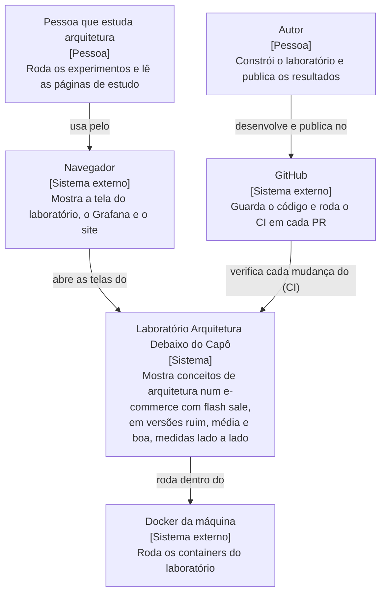

# C4 · Nível 1: contexto

O **modelo C4** descreve um sistema em quatro níveis de zoom, cada um para um público. O **nível 1, contexto**, é o mais aberto: mostra o sistema como uma caixa só, quem o usa e com que outros sistemas ele conversa. Serve para qualquer pessoa entender, em um minuto, do que se trata, sem nenhum detalhe técnico interno.

| Elemento | O que é |
|---|---|
| Pessoa que estuda arquitetura | Quem roda os experimentos na própria máquina e lê as explicações |
| Autor | Quem constrói o laboratório, mede e publica os resultados |
| Laboratório | O sistema inteiro: a tela, a aplicação, o banco, a observabilidade e o site (detalhados no [nível 2](c4-2-containers.md)) |
| Navegador | Onde a pessoa vê a tela do laboratório, o Grafana e as páginas de estudo |
| Docker da máquina | Onde todos os containers rodam, com as portas presas a `127.0.0.1` (ADR-013) |
| GitHub | Onde o código fica e onde o CI confere cada PR (gates, harness, segredos, dependências) |
