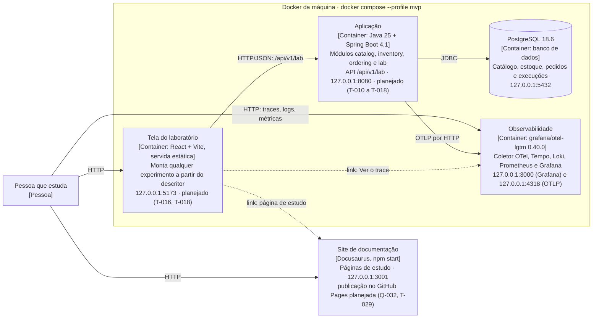

# C4 · Nível 2: containers

No modelo C4, um **container** é qualquer coisa que roda e guarda dados ou executa código: uma aplicação, um banco, um site. (Não é o mesmo que um container Docker, embora aqui quase todos rodem num.) O **nível 2** abre a caixa do [nível 1](c4-1-contexto.md) e mostra esses containers, as tecnologias de cada um e como eles conversam. Serve para quem vai desenvolver, operar ou estudar o sistema.

Os elementos marcados como **planejado** ainda não existem; chegam nas tarefas indicadas.

| Container | Tecnologia | O que faz | Decisões |
|---|---|---|---|
| Tela do laboratório | React, TypeScript, Vite, Recharts | Monta a tela de cada experimento a partir do descritor e mostra as medições | ADR-005, ADR-020, ADR-023 |
| Aplicação | Java 25, Spring Boot 4.1, Maven | Executa os experimentos, uma execução por vez, e carrega os dados de referência | ADR-001 a ADR-004, ADR-006 a ADR-009, ADR-018, ADR-021 |
| PostgreSQL | PostgreSQL 18.6 | Guarda catálogo, estoque, pedidos e execuções; o volume persiste entre as subidas | ADR-009, ADR-014, ADR-017, ADR-019 |
| Observabilidade | grafana/otel-lgtm | Recebe a telemetria por OTLP e a mostra no Grafana | ADR-010, ADR-015, ADR-016, ADR-026 |
| Site de documentação | Docusaurus, Node 26 | As páginas de estudo, com comandos em bash e PowerShell; roda na máquina por `npm start`, fora do Docker (Q-030) | ADR-022 |

O nível 3 (os componentes dentro da aplicação) entra quando os módulos existirem, na Fase 1.
