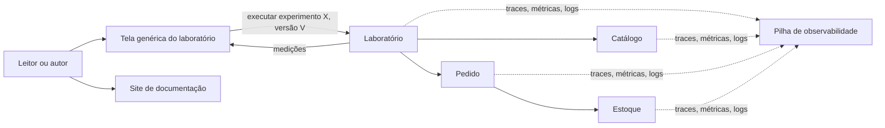

# 01 · Domínios e Capacidades

Escopo: o MVP (`docs/produto/mvp.md`). Os requisitos (RF/RNF) estão em `02-requirements.md`.

## 1. Domínios
| Domínio | Responsabilidade | Dono dos dados | Não faz |
|---|---|---|---|
| Catálogo (`catalog`) | Produtos e categorias, com volume grande, para os experimentos de leitura | Tabelas de produto e categoria | Não controla estoque nem preço de venda da flash sale |
| Estoque (`inventory`) | Quantidade disponível de cada produto na flash sale e a reserva de unidades | Saldo de estoque | Não cria pedidos |
| Pedido (`ordering`) | Registrar a compra de um comprador na flash sale | Pedidos (`customer_order`); expõe na API a contagem de pedidos de uma execução | Não altera estoque diretamente: pede ao Estoque pela API pública dele |
| Laboratório (`lab`) | Catálogo de experimentos (descritores), execução das versões, coleta e entrega das medições | Resultados das execuções | Não contém regra de negócio da loja; não executa código enviado pelo usuário |
| Documentação (site) | Páginas de estudo, glossário, matriz de versões | Conteúdo do site | Não executa experimentos |

Observabilidade é transversal: todos os domínios emitem traces, métricas e logs (F5).

## 2. Capacidades de negócio
| Capacidade | Domínio | Requisitos |
|---|---|---|
| Subir o ambiente e carregar volume grande de dados (F1) | infra + Catálogo | RF-001, RNF-001, RNF-007, RNF-008 |
| Listar, buscar e detalhar produtos, nas versões do experimento de lista e do N+1 (F2, F3) | Catálogo + Laboratório | RF-005, RF-006, RNF-002 |
| Disputar as últimas unidades: venda ingênua × venda correta (F4) | Estoque + Pedido + Laboratório | RF-007, RNF-002 |
| Executar um experimento e ver as medições na tela genérica (F2–F4) | Laboratório + front-end | RF-002, RF-003, RF-004, RF-008, RNF-003 |
| Ver a telemetria de uma execução (F5) | transversal | RF-009 |
| Ler a página de estudo de cada experimento (F6) | Documentação | RF-010, RNF-006 |

## 3. Limites e integração
- Tudo roda num único processo (monólito modular). A comunicação entre módulos é **síncrona, em memória**, apenas pela API pública de cada módulo. Mensageria fica para a fatia 5.
- Cada módulo expõe um pacote `api`. Proibido: um módulo acessar as tabelas ou as classes internas de outro. Verificado por teste de arquitetura (RNF-004).
- **Exceção declarada:** as versões ruins ficam num pacote `experiment` do módulo dono do dado. Esse pacote é uma API restrita: só `lab` e outros pacotes `experiment` dependem dele (exemplo: `ordering.experiment` usa `inventory.experiment`).
- Direção das dependências: `lab` → `ordering`, `inventory`, `catalog`; `ordering` → `inventory`. Nenhum módulo de negócio depende do `lab`, e `customer_order` não tem chave estrangeira para `lab_run` (D-17).
- Chave estrangeira entre tabelas de módulos diferentes: só para `product(id)`, um acoplamento aceito e registrado no ADR-002.
- A carga dos dados de referência é orquestrada pelo `lab`; cada módulo carrega e limpa as próprias tabelas pela API dele (D-09).
- O Laboratório chama os módulos de negócio como um cliente qualquer; a versão ruim nunca é usada fora do Laboratório.
- O front-end conversa só com a API do Laboratório (contrato OpenAPI).

## 4. Fluxo principal

