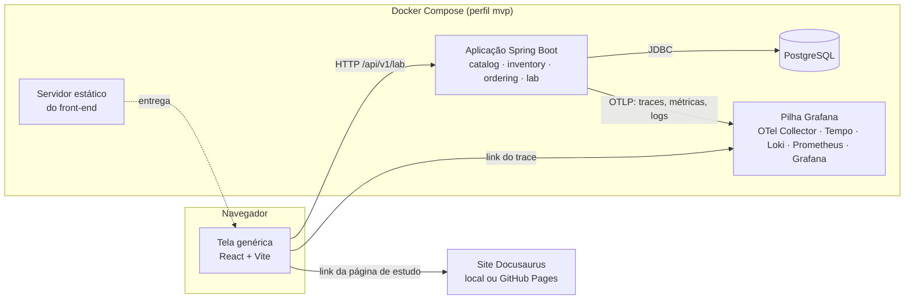

# 03 · Design e Contratos

Escopo: o MVP. Revisado conforme `spec-reviews/SPEC-REVIEW-001.md`. Cada decisão `D-nn` (e cada escolha de stack de `00 §3`) vira exatamente um ADR em `docs/architecture/decisions/` na T-005, com a alternativa rejeitada.

## 1. Decisões de design
| ID | Decisão | Motivo | Alternativa rejeitada | ADR |
|---|---|---|---|---|
| D-01 | Monólito modular num único processo Spring Boot, com módulos `catalog`, `inventory`, `ordering` e `lab` | MVP de um autor; módulos com fronteiras verificadas preparam a extração futura (Strangler Fig, fatia 5) | Microsserviços já no MVP: rede, deploy e dados distribuídos sem nenhum requisito do MVP que precise disso (P2) | ADR-001 |
| D-02 | Profundidade por módulo: `catalog` em camadas com JPA; `inventory` e `ordering` em hexagonal enxuta (domínio puro); `lab` em camadas. Cada módulo expõe um pacote `api`; as versões ruins ficam num pacote `experiment`, que é uma API restrita ao `lab` (`01 §3`) | P2: hexagonal só onde há regra e concorrência | Hexagonal em todos (mapeamento duplicado no catálogo, sem ganho); camadas em todos (a regra do estoque ficaria acoplada ao JPA) | ADR-002 |
| D-03 | Execução **síncrona e no mesmo processo**: o `POST` só responde quando o experimento termina | As execuções do MVP duram segundos; simples de entender e de testar | `202 Accepted` + consulta periódica: mais estado e mais código, sem execução longa no MVP que justifique | ADR-003 |
| D-04 | Uma execução por vez, garantida por *advisory lock* do PostgreSQL (`pg_try_advisory_lock`) | Medições concorrentes se contaminam (P3); a trava no banco continua valendo com várias instâncias (fatia 4) | Flag em memória: quebra com 2 instâncias. Fila de execuções: complexidade sem necessidade | ADR-004 |
| D-05 | Experimentos descritos por arquivos JSON (`classpath*:lab/experiments/*.json`), validados por JSON Schema na inicialização; o front-end monta a tela a partir deles. Testes acrescentam descritores próprios pelo classpath de teste (`§4.1`) | Uma tela serve para todos os experimentos (Q-002) e mantém cada experimento como um módulo autodescrito (DP-21) | Uma tela feita à mão por experimento; descritores no banco (sem necessidade de editar em tempo de execução) | ADR-005 |
| D-06 | Método de medição de `list-intersection` e `n-plus-one`: 2 aquecimentos descartados + `repetitions` medidas, publicando mediana, mínimo e máximo; o tempo vem de uma porta `Stopwatch` (implementação com `System.nanoTime`). A flash sale roda **uma vez por versão, sem aquecimento** | P7: dispersão visível e JIT aquecido, testável com relógio falso. Na flash sale, um aquecimento gravaria pedidos e consumiria estoque | Média de uma única execução (esconde o ruído); JMH como único método (fica como diferencial; não roda dentro da API) | ADR-006 |
| D-07 | Contagem de SQL pelas estatísticas do Hibernate (`Statistics#getPrepareStatementCount`), zeradas antes de cada medição e lidas no fim | Número exato, sem depender da telemetria; confiável porque só há uma execução por vez (D-04) | Contar os spans de SQL da telemetria (D-15): servem para **ver** no trace, mas o número do experimento não deve depender da exportação; contar linhas de log (frágil) | ADR-007 |
| D-08 | Flash sale: versão correta = `UPDATE ... SET available = available - 1 WHERE product_id = ? AND available >= 1` na mesma transação que grava o pedido; versão ingênua = ler numa transação curta, esperar a janela de corrida **sem segurar conexão**, e gravar o valor calculado na aplicação em outra transação. Compradores simulados no mesmo processo, com *virtual threads* liberadas juntas por um latch | Mostra a condição de corrida e a correção mais simples (o banco decide de forma atômica). Ler e gravar em transações separadas é o padrão ingênuo mais comum e não prende o pool durante a espera | Carga HTTP com k6 (fica para a fatia 4); trava pessimista e otimista (fatia 3 completa); ler e esperar dentro da mesma transação (trava o pool, SPEC-REVIEW-001 #1) | ADR-008 |
| D-09 | Dados de referência gerados por SQL determinístico (`generate_series` + fórmulas aritméticas com tipos explícitos, sem aleatoriedade), com limpeza e carga na **mesma** transação, quando o banco está vazio ou o tamanho configurado mudou. Cada módulo carrega e limpa as próprias tabelas pela API dele; o `lab` orquestra | Rápido, reprodutível (AC-001.3), sem arquivo de 1 milhão de linhas no repositório, e sem um módulo mexer nas tabelas de outro | CSV versionado (centenas de MB no git); gerador em Java com dados aleatórios (lento e não determinístico); um script único que escreve em todas as tabelas (viola `01 §3`) | ADR-009 |
| D-10 | Observabilidade do MVP: um único container da pilha Grafana para desenvolvimento (coletor OpenTelemetry + Tempo + Loki + Prometheus + Grafana), recebendo traces, métricas e logs por OTLP; a aplicação usa o suporte nativo do Spring Boot, Micrometer + OTLP (Q-008) | Cabe na memória (RNF-007) e sobe com um serviço | Os 5 componentes em containers separados: ficam para a fatia 7, onde cada um é ensinado | ADR-010 |
| D-11 | A aplicação e o front-end também rodam em containers no `compose.yaml` (perfil `mvp`); rodar por `mvnw` e `npm` continua disponível como modo de desenvolvimento | ≤ 3 comandos sem instalar Java nem Node (RNF-001) | Exigir Java 25 e Node instalados como caminho principal (mais pré-requisitos para o leitor) | ADR-011 |
| D-12 | Erros HTTP em Problem Details (RFC 9457) com `type` relativo `/problems/<código>` e, em erros de validação, a lista `errors` com `{field, message}` | Formato padrão, legível pela tela genérica | Formato próprio de erro | ADR-012 |
| D-13 | Sem autenticação; portas publicadas só em `127.0.0.1` | A5: laboratório local, sem multiusuário | Login no MVP (sem requisito, DP-21) | ADR-013 |
| D-14 | Migrações de banco com Flyway, em arquivos SQL versionados (`V1__...sql`) | SQL puro é o mais fácil de ler e de explicar; o Spring Boot integra sem configuração | Liquibase: mais poderoso (XML/YAML, rollback), mas acrescenta uma linguagem a aprender sem ganho no MVP | ADR-014 |
| D-15 | Consultas SQL como spans no trace com `net.ttddyy.observation:datasource-micrometer` (Q-009), versão confirmada na T-004 | Ver 51 spans contra 1 no trace é a imagem central do experimento N+1 | Tirar os spans de SQL do MVP (perde a demonstração visual); agente Java do OpenTelemetry (fica para a fatia 7, Q-008) | ADR-015 |
| D-16 | Logs em JSON na saída padrão **e** enviados por OTLP com o appender Logback do OpenTelemetry (Q-010), dependência confirmada na T-004 | Liga log ↔ trace no Grafana sem um container extra | Só na saída padrão (sem Loki no MVP); coletor dos logs do Docker, como o Grafana Alloy (mais memória e mais um componente) | ADR-016 |
| D-17 | `customer_order` guarda `lab_run_id` e `lab_variant` como valores simples, **sem** chave estrangeira para `lab_run`; trocar o tamanho da carga apaga catálogo, estoque e pedidos, mas preserva `lab_run` (Q-011) | As execuções são a prova das medições publicadas (P7, RNF-011); sem a FK, `ordering` não depende do `lab` | Apagar as execuções na recarga (destrói a prova); recusar subir com outro tamanho (pouco prático) | ADR-017 |

Escolhas do autor em `open-questions.md`, já aplicadas nesta spec: **Q-005** (gráfico com Recharts), **Q-006** (barreira injetável no teste e `raceWindowMs` no laboratório), **Q-007** (só ArchUnit no MVP), **Q-008** (suporte nativo do Spring Boot), **Q-009** (D-15), **Q-010** (D-16) e **Q-011** (D-17).

## 2. Componentes

- **Aplicação:** expõe a API do laboratório, executa os experimentos e orquestra a carga dos dados de referência.
- **PostgreSQL:** catálogo, estoque, pedidos e execuções.
- **Pilha Grafana:** recebe a telemetria por OTLP e mostra traces, logs e métricas. A fonte de dados do Tempo é provisionada com UID `tempo` (AC-008.6).
- **Servidor estático:** entrega a tela do laboratório já compilada, com o header `X-Content-Type-Options: nosniff`.
- **Site:** as páginas de estudo, publicadas separadamente.

Portas publicadas no `compose.yaml`, todas em `127.0.0.1` (D-13): tela do laboratório `5173`, API `8080`, Grafana `3000`, PostgreSQL `5432`.

Configuração da tela (variáveis de build do Vite): `VITE_API_URL` (padrão `http://localhost:8080`) e `VITE_GRAFANA_URL` (padrão `http://localhost:3000`). Configuração da aplicação: `LAB_SEED_PRODUCTS` (padrão `1000000` no compose; `10000` nos testes).

## 3. Modelo de dados
Migrações versionadas com Flyway (D-14). Todos os tempos em `timestamptz` (UTC). Chaves estrangeiras entre tabelas de módulos diferentes são permitidas só para `product(id)`, como acoplamento aceito e registrado no ADR-002.

**`category`** (dono: `catalog`)
| Coluna | Tipo | Constraint |
|---|---|---|
| `id` | `bigint` | PK |
| `name` | `varchar(100)` | NOT NULL, UNIQUE |

**`product`** (dono: `catalog`)
| Coluna | Tipo | Constraint |
|---|---|---|
| `id` | `bigint` | PK |
| `sku` | `varchar(20)` | NOT NULL, UNIQUE; formato `SKU-` + 7 dígitos |
| `name` | `varchar(200)` | NOT NULL |
| `category_id` | `bigint` | NOT NULL, FK → `category(id)`; índice `ix_product_category` |
| `price` | `numeric(12,2)` | NOT NULL, CHECK (`price > 0`); mapeado como `BigDecimal` |
| `created_at` | `timestamptz` | NOT NULL |

**`product_attribute`** (dono: `catalog`)
| Coluna | Tipo | Constraint |
|---|---|---|
| `id` | `bigint` | PK |
| `product_id` | `bigint` | NOT NULL, FK → `product(id)`; índice `ix_attribute_product` |
| `name` | `varchar(50)` | NOT NULL; UNIQUE (`product_id`, `name`) |
| `value` | `varchar(200)` | NOT NULL |

**`flash_sale_stock`** (dono: `inventory`)
| Coluna | Tipo | Constraint |
|---|---|---|
| `product_id` | `bigint` | PK, FK → `product(id)` |
| `initial_quantity` | `integer` | NOT NULL, CHECK (`initial_quantity BETWEEN 1 AND 100`) |
| `available` | `integer` | NOT NULL, CHECK (`available >= 0`) |

**`customer_order`** (dono: `ordering`; `order` é palavra reservada do SQL)
| Coluna | Tipo | Constraint |
|---|---|---|
| `id` | `uuid` | PK (gerado pelo gerador de IDs injetado) |
| `product_id` | `bigint` | NOT NULL, FK → `product(id)` |
| `quantity` | `integer` | NOT NULL, CHECK (`quantity > 0`) |
| `lab_run_id` | `uuid` | NULL; **sem** FK (D-17); índice `ix_order_lab_run` (`lab_run_id`, `lab_variant`) |
| `lab_variant` | `varchar(10)` | NULL; CHECK (`lab_variant IN ('bad','medium','good')`) |
| `created_at` | `timestamptz` | NOT NULL (do `Clock` injetado) |

**`lab_run`** (dono: `lab`)
| Coluna | Tipo | Constraint |
|---|---|---|
| `id` | `uuid` | PK (gerado pelo gerador de IDs injetado) |
| `experiment_id` | `varchar(50)` | NOT NULL |
| `status` | `varchar(20)` | NOT NULL, CHECK (`status IN ('RUNNING','COMPLETED','FAILED')`) |
| `parameters` | `jsonb` | NOT NULL (parâmetros efetivos) |
| `results` | `jsonb` | NULL até concluir; NULL em `FAILED` |
| `failure_reason` | `varchar(500)` | NULL; preenchido em `FAILED` |
| `environment` | `jsonb` | NOT NULL: `javaVersion`, `springBootVersion`, `postgresVersion`, `osName`, `osArch`, `availableProcessors`, `maxHeapMb`, `dbPoolSize`, `seedProducts` |
| `trace_id` | `varchar(32)` | NOT NULL |
| `started_at` | `timestamptz` | NOT NULL (do `Clock`) |
| `finished_at` | `timestamptz` | NULL até concluir |

### 3.1 Algoritmos críticos

**A1 · Carga dos dados de referência (D-09)**
1. Na inicialização, ler `LAB_SEED_PRODUCTS` (padrão `1000000`). Se não for um inteiro entre 1 e 1.000.000, falhar a inicialização (AC-001.4). Enquanto a carga roda, o *readiness* da aplicação fica `DOWN` (AC-008.9).
2. Antes da carga: marcar como `FAILED` toda linha `RUNNING` de `lab_run` (AC-004.4).
3. Se `SELECT count(*) FROM product` = valor configurado, registrar `seed.skipped` e terminar (AC-001.2).
4. Senão, numa **única transação** que contém a limpeza e a carga (AC-001.5, AC-001.6), o `lab` chama, nesta ordem: `ordering.api` limpa `customer_order`; `inventory.api` limpa `flash_sale_stock`; `catalog.api` limpa e carrega o catálogo; `inventory.api` carrega o estoque. `lab_run` não é tocada (D-17).
   - categorias 1..50, com `name` = `Categoria ` + número com 2 dígitos;
   - produtos `i` = 1..N (`generate_series(1, N)` em `bigint`), com `sku` = `'SKU-' || lpad(i::text, 7, '0')`, `name` = `'Produto ' || i`, `category_id` = `1 + (i % 50)`, `price` = `10.00 + ((i * 7919) % 99000)::numeric / 100` e `created_at` = `'2026-01-01T00:00:00Z'` (constante, para o determinismo);
   - atributos: o produto `i` tem `3 + (i % 6)` atributos, com `name` = `'attr-' || k` (k = 1..) e `value` = `'valor-' || ((i * k * 31) % 1000)`;
   - `flash_sale_stock` para o produto 1, com `initial_quantity` = 10 e `available` = 10.
5. Ponto de falha de teste: uma porta `SeedFailpoint`, chamada entre a carga dos produtos e a dos atributos; em produção não faz nada; no teste, lança exceção (AC-001.5).
6. Depois do commit: registrar `seed.completed` com `products` e `duration_ms`, atualizar o gauge de duração (RNF-008) e liberar o *readiness*.

**A2 · Execução de um experimento (RF-003)**
1. Resolver o descritor pelo id → `404 experiment-not-found`.
2. Corpo acima de 16 KB → `413 payload-too-large`; corpo que não é JSON → `400 malformed-request`.
3. Validar o corpo contra o descritor (versões existentes e não vazias; parâmetros conhecidos, de tipo certo e dentro dos limites; padrões aplicados) → `400 invalid-parameter`.
4. Validar as regras de negócio, nesta ordem: limite de tamanho por versão → `422 size-exceeds-variant-limit`; tamanho maior que os produtos carregados → `422 insufficient-data`.
5. Tentar `pg_try_advisory_lock(<chave fixa do laboratório>)` numa conexão dedicada → se `false`, `409 run-in-progress`.
6. Abrir o span `lab.run` (filho do span HTTP do Spring) e gravar `lab_run` com `status` `RUNNING` e o `trace_id` do trace corrente.
7. Para cada versão × tamanho, na ordem do pedido: preparar as entradas **fora** da medição; abrir o span `lab.variant`; executar conforme o método do experimento (D-06); fechar o span.
8. Calcular o `checksum` de cada resultado e a verificação de comparação justa (`fairness`).
9. Gravar `results`, `finished_at` e `status` `COMPLETED`; registrar `lab.run.completed`; atualizar as métricas.
10. Em qualquer exceção nos passos 6–9: gravar `status` `FAILED` e `failure_reason`, registrar `lab.run.failed` e responder `500 run-failed` com `runId`.
11. **Sempre** (`finally`): liberar o advisory lock.

**A3 · Interseção de listas (RF-005)**
1. Entradas, fora da medição: os n primeiros SKUs do catálogo (por `id`), como "catálogo em memória". O lote: copiar o catálogo, embaralhar a cópia com `Collections.shuffle(copia, new Random(42))` e pegar os n/2 primeiros (existentes, sem repetição); somar n/2 SKUs inexistentes (`MISS-` + 1..n/2); embaralhar o lote com `new Random(42)`.
2. `bad`: para cada SKU do lote, `catalogList.contains(sku)` → O(n²).
3. `medium`: ordenar uma cópia do catálogo e usar `Collections.binarySearch` para cada SKU → O(n log n).
4. `good`: montar um `HashSet` do catálogo e testar cada SKU → O(n).
5. Saída: `matches` (quantidade encontrada) e `checksum` = SHA-256, em hexadecimal, dos SKUs encontrados (todos distintos, pela construção do lote), em ordem alfabética, unidos por `\n`.
6. Limites: `bad` até 20.000 [meta: escolhido para uma execução da versão ruim ficar em segundos no ambiente A2; a calibrar]; `medium` e `good` até 1.000.000.

**A4 · N+1 (RF-006)**
1. Para cada valor de `pageSizes`, a página são os produtos com `id` de 1 até o valor, ordenados por `id`.
2. `bad`: buscar a página de entidades `Product` e acessar `getAttributes()` de cada uma (relação preguiçosa) → 1 + n comandos SQL.
3. `medium`: a mesma consulta, com *batch fetching* de tamanho 25 na relação → 1 + ⌈n/25⌉.
4. `good`: uma única consulta com `JOIN` de `product` e `product_attribute`, projetada para DTO → 1.
5. Antes de cada medição: limpar o contexto de persistência (para nada vir do cache de primeiro nível) e zerar as estatísticas (D-07).
6. Saída: `sqlStatements`, `products`, `attributes`, `durationMsMedian`, `durationMsMin`, `durationMsMax` e `checksum` (SHA-256 da lista `sku:nome=valor`, ordenada por `id` e depois pelo `name` do atributo).
7. Armadilha documentada na página de estudo: `JOIN FETCH` com paginação faz o Hibernate paginar em memória; por isso a versão `good` usa projeção.

**A5 · Últimas unidades da flash sale (RF-007)**
1. Para cada versão escolhida, **antes** de rodá-la e fora da medição, o `lab` pede ao `inventory.api` que reinicie o estoque do produto 1: `initial_quantity` = `available` = `initialStock`.
2. Criar `buyers` tarefas em *virtual threads*; todas esperam um `CountDownLatch` e são liberadas juntas. A latência de cada compra é medida da liberação do latch até o fim da transação de gravação, incluindo a espera por conexão.
3. `good`: o caso de uso `ordering.application.PlaceFlashSaleOrder`, numa transação: chama `inventory.api.reserveIfAvailable(productId, 1)`, que executa o `UPDATE` condicional de D-08; se afetou 1 linha, insere o pedido com `lab_run_id` e `lab_variant` = `good`; se afetou 0, conta como esgotado.
4. `bad`: `ordering.experiment.NaivePlaceOrder`, usando `inventory.experiment.RawStockAccess`:
   1. transação 1 (curta): ler `available`; a conexão volta ao pool;
   2. se `available` = 0, contar como esgotado e parar;
   3. esperar a janela de corrida, sem conexão: a porta `RaceWindow` tem duas implementações; no laboratório, uma pausa de `raceWindowMs` (0 = sem pausa); no teste, uma barreira que só libera quando todos os compradores terminaram o passo 1 (Q-006). É o único ponto do código de produção com pausa proposital, restrito à versão ruim e explicado na página de estudo;
   4. transação 2: gravar `available = lido - 1` e inserir o pedido com `lab_variant` = `bad`.
5. A concorrência real de gravação é limitada pelo pool de conexões, cujo tamanho aparece em `environment.dbPoolSize` e na página de estudo.
6. Saída por versão: `unitsSold` (pedidos com o `lab_run_id` **e** a `lab_variant`, contados por `ordering.api`), `oversold` = max(0, `unitsSold` − `initialStock`), `finalAvailable`, `rejectedSoldOut`, `durationMs`, `purchasesPerSecond` e `latencyP95Ms`.

## 4. Contrato do descritor de experimento
O MVP não publica eventos de mensageria (fatia 5). O contrato versionado é o descritor: fonte da verdade em `lab/experiments/experiment.schema.json` (JSON Schema), um arquivo por experimento.

| Campo | Tipo | Regra |
|---|---|---|
| `schemaVersion` | inteiro | `1` |
| `id` | texto | `^[a-z0-9-]{3,50}$`, igual ao nome do arquivo |
| `title`, `summary` | texto | obrigatórios, em português |
| `studyPage` | texto | caminho dentro de `site/docs/` (AC-010.4) |
| `fairness` | enum | `same-result` · `demonstrates-error` |
| `evidenceMeasurement` | texto | obrigatório quando `fairness` = `demonstrates-error` (AC-RNF-002.2) |
| `variants[]` | lista (≥ 2) | `{id: bad\|medium\|good, label, description, complexity?, sourceRef, maxSize?}` |
| `parameters[]` | lista | `{name, label, type: integer\|integer-set, default, min?, max?, allowed?, isSize?}`; no máximo um parâmetro com `isSize` = `true` (é o "tamanho" dos resultados) |
| `measurements[]` | lista (≥ 1) | `{id, label, unit}` |
| `chart` | objeto, opcional | `{x: <parâmetro com isSize>, y: <id de medição>, scale: linear\|log}` |
| `verificationQuestions[]` | lista (3 a 5) | texto |

Parâmetros, medições e gráfico do MVP:
| Experimento | Parâmetros (tipo · permitido · padrão) | Medições | `chart` |
|---|---|---|---|
| `list-intersection` | `sizes` (conjunto, `isSize`) · {1000, 5000, 10000, 20000, 100000, 1000000} · [1000, 5000, 10000, 20000]; `repetitions` (inteiro) · 1–10 · 5 | `durationMsMedian`, `durationMsMin`, `durationMsMax` (ms); `matches` (itens) | x = `sizes`, y = `durationMsMedian`, `log` |
| `n-plus-one` | `pageSizes` (conjunto, `isSize`) · {10, 50, 100, 500} · [10, 50, 100, 500]; `repetitions` (inteiro) · 1–10 · 5 | `sqlStatements` (comandos); `durationMsMedian`, `durationMsMin`, `durationMsMax` (ms); `products`, `attributes` (itens) | x = `pageSizes`, y = `sqlStatements`, `linear` |
| `flash-sale-last-units` | `initialStock` (inteiro) · 1–100 · 10; `buyers` (inteiro) · 10–2000 · 1000; `raceWindowMs` (inteiro) · {0, 1, 5} · 1 | `unitsSold`, `oversold`, `finalAvailable`, `rejectedSoldOut` (unidades); `durationMs`, `latencyP95Ms` (ms); `purchasesPerSecond` (compras/s) | sem gráfico |

`raceWindowMs` só afeta a versão `bad`; a versão `good` não tem janela entre ler e gravar.

### 4.1 Descritores só de teste
Ficam em `backend/src/test/resources/lab/experiments/` e só existem no classpath de teste:
- `test-blocking`: uma versão que, dentro da execução (portanto com a trava segura), espera um sinal controlado pelo teste (AC-003.8).
- `test-failing`: uma versão que lança uma exceção (AC-003.9).
- `test-fictional`: um quarto experimento para a tela genérica (AC-008.2, como fixture do front-end).

## 5. Contratos de API
Base `/api/v1/lab`. Fonte da verdade: `backend/src/main/resources/openapi/lab-api.yaml` (contract-first), com exemplo obrigatório para cada status declarado.

| Método e rota | Scope | Sucesso | Erros |
|---|---|---|---|
| `GET /api/v1/lab/experiments` | público local (D-13) | 200 | — |
| `GET /api/v1/lab/experiments/{experimentId}` | público local | 200 | 404 |
| `POST /api/v1/lab/experiments/{experimentId}/runs` | público local | 201 + `Location` | 400, 404, 409, 413, 422, 500 |
| `GET /api/v1/lab/runs/{runId}` | público local | 200 | 400, 404 |
| `GET /actuator/health/readiness` | público local | 200 (`UP`) | 503 (`DOWN`, durante a carga) |

Corpo do `POST`: `{"variants": ["bad","good"], "parameters": {"sizes": [1000, 5000], "repetitions": 3}}`.

Corpo de sucesso (201 e 200): `id`, `experimentId`, `status`, `startedAt`, `finishedAt`, `traceId`, `environment`, `parameters` (efetivos), `results[]` = `{variant, size?, measurements: {<id>: número}, checksum?}`, `fairness` = `{type, sameResult?}` e `failureReason` (só em `FAILED`).

CORS: só a origem `http://localhost:5173` é permitida (AC-RNF-009.4).

### 5.1 Erros (`application/problem+json`, D-12)
| Status | `type` | Quando |
|---|---|---|
| 400 | `/problems/malformed-request` | Corpo que não é JSON válido |
| 400 | `/problems/invalid-parameter` | Versão ou parâmetro desconhecido, ausente quando obrigatório, de tipo errado ou fora dos limites; id de execução que não é UUID. Inclui `errors[]` |
| 404 | `/problems/experiment-not-found` | Experimento inexistente |
| 404 | `/problems/run-not-found` | Execução inexistente |
| 409 | `/problems/run-in-progress` | Outra execução segura a trava (D-04) |
| 413 | `/problems/payload-too-large` | Corpo acima de 16 KB [meta] |
| 422 | `/problems/size-exceeds-variant-limit` | Tamanho acima de `maxSize` de uma versão escolhida |
| 422 | `/problems/insufficient-data` | Tamanho maior que os produtos carregados |
| 500 | `/problems/run-failed` | Exceção durante a execução. Inclui `runId`; nunca o stack trace |

Precedência: `404` → `413` → `400` → `422 size-exceeds-variant-limit` → `422 insufficient-data` → `409` (AC-003.10).

## 6. Segurança e auditoria
- Sem autenticação; o isolamento vem de publicar as portas só em `127.0.0.1` (D-13, RNF-009).
- A API só aceita ids e parâmetros declarados nos descritores; nenhum texto livre chega a SQL, ao sistema de arquivos ou à execução de código.
- Nunca vão para log: corpos completos de requisição, variáveis de ambiente, senhas (a senha do banco local fica no `.env`, fora do git; o repositório só tem o `.env.example`).
- Auditoria: cada execução fica em `lab_run`, com parâmetros, ambiente e `trace_id`, e sobrevive às recargas (D-17). É a base das medições publicadas (P7).

## 7. Resiliência e capacidade
- O MVP não tem dependências externas além do banco local; não há retry nem circuit breaker (fatia 5).
- Timeout do cliente HTTP da tela para o `POST`: 120 s [meta] (AC-008.8). Como a execução é síncrona (D-03), não há como recuperar o resultado depois de um timeout; a tela orienta a usar um tamanho menor.
- Pool de conexões: tamanho padrão do Spring Boot, registrado em `environment.dbPoolSize`.
- Limites de memória por container no `compose.yaml` (RNF-007).

## 8. Observabilidade
Nome no código (Micrometer) → nome exportado (Prometheus):

| Sinal | Nome no código → exportado | Tipo | Labels / atributos | Para quê |
|---|---|---|---|---|
| Métrica | `lab.runs` → `lab_runs_total` | counter | `experiment`, `status` | Quantas execuções e quantas falharam |
| Métrica | `lab.run.duration` → `lab_run_duration_seconds` | timer com histograma | `experiment` | Duração das execuções (percentis pelo histograma, não por média) |
| Métrica | `lab.seed.duration` → `lab_seed_duration_seconds` | gauge | — | Tempo da última carga (RNF-008) |
| Trace | `lab.run` | span, filho do span HTTP | `lab.experiment.id`, `lab.run.id` | Uma execução |
| Trace | `lab.variant` | span | `lab.experiment.id`, `lab.variant`, `lab.size` | Uma versão × tamanho |
| Trace | consultas SQL | spans filhos de `lab.variant` (D-15) | o comando SQL, sem os valores dos parâmetros | Ver o N+1 no trace |
| Log | `lab.run.completed` / `lab.run.failed` | evento JSON | `run_id`, `experiment_id`, `status`, `duration_ms`, `trace_id` | Ligar o log ao trace |
| Log | `seed.completed` / `seed.skipped` | evento JSON | `products`, `duration_ms` | Acompanhar a carga |

Todas as linhas de log são JSON, com `timestamp`, `level`, `service.name`, `trace_id` e `span_id`, escritas na saída padrão e enviadas por OTLP (D-16). Nenhum label de métrica tem cardinalidade ilimitada (nunca `run_id` como label).
