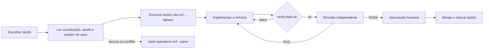

# 05 · Harness de Execução (SDD)

## 1. Objetivo
Garantir que cada tarefa seja implementada **exatamente** como especificado: sem decisões improvisadas, sem escopo extra, com evidência automática e revisão independente.

## 2. Ciclo por tarefa

## 3. Contrato da tarefa (`docs/specs/tasks/T-xxx.md`)
Modelo em `docs/specs/templates/tarefa.md`. Frontmatter: `id`, `title`, `depends_on`, `covers`, `evidence_only`, `allowed_paths`, `allowed_new_dependencies`. Seções: Objetivo, Entradas, Decisões da tarefa, Saídas, Critérios de aceite, Testes exigidos, Não-objetivos, Checklist de pronto.

Se a tarefa muda como subir ou usar a aplicação, `README.md` (e guias de uso) entram nos `allowed_paths` (README vivo).

**Stack isolada para executar o README.** Os comandos são executados num clone limpo e numa stack que não é a do autor: nome de projeto do compose próprio, portas livres, e ao fim só os processos dessa stack são encerrados. A evidência registra o shell, a versão e o resultado de cada passo.

## 4. Gate automático `scripts/verify-task.sh T-xxx`
Falha (exit ≠ 0) se qualquer item falhar; roda todos os itens mesmo após uma falha e grava `docs/specs/reviews/T-xxx.verify.log`. Base do diff: variável `BASE` (padrão: branch principal). Configuração em `scripts/sdd.conf`. Itens baratos primeiro e build por último; `--rapido` pula o build (exit 3, "verde parcial") para iterar e nunca vale como gate final.
0. **Contrato:** `scripts/sdd-lint-task.sh T-xxx` sem erro (pronto para executar: seções, covers em 02, uma linha de "Testes exigidos" por AC, sem placeholder, Q citadas decididas, dependências concluídas).
1. **Build:** `./mvnw -q verify` (backend) verde e, quando a tarefa toca `frontend/` ou `site/`, também `npm run verify` dentro da pasta afetada. Os comandos exatos são fixados na T-002.
2. **Escopo:** arquivos do diff ⊆ `allowed_paths` (exceto `docs/specs/reviews/**` e `docs/specs/traceability.md`).
3. **Dependências:** nenhuma dependência nova fora de `allowed_new_dependencies`.
4. **Rastreabilidade:** cada ID de `covers` fora de `evidence_only` aparece numa marcação de teste criada/alterada no diff; `traceability.md` versionado igual ao gerado.
5. **Padrões proibidos** nas linhas adicionadas: `TODO`, `FIXME`, `System.out.println`/`printStackTrace` e `console.log` fora de scripts, teste desabilitado (`@Disabled`, `it.skip`), `Thread.sleep`/`setTimeout` em teste, `double`/`float` para dinheiro, imagem Docker sem tag fixa (`:latest`).
6. **Artefatos:** caminhos citados em "Saídas" existem.

## 5. Revisão independente
Executada por um revisor **sem o contexto de raciocínio do implementador** (outra sessão/subagente). Entradas: tarefa, seções de spec referenciadas, diff, log do gate. Saída: `docs/specs/reviews/T-xxx.md` (exclusivo do revisor; a evidência do implementador é `T-xxx.evidence.md`).

### Rubrica
| # | Item | Falha quando |
|---|---|---|
| R1 | Critérios de aceite | Algum AC sem teste que o prove (citar `arquivo#teste`) |
| R2 | Escopo | Arquivo fora de `allowed_paths` ou funcionalidade não pedida |
| R3 | Decisões não previstas | Qualquer escolha não presente na spec/ADR (deve ser zero) |
| R4 | Dependências | Biblioteca nova sem autorização |
| R5 | Segurança | Segredo no código ou no repositório; dado pessoal ou segredo em log; erro devolvendo stack trace; endpoint do laboratório que aceita código, SQL ou caminho de arquivo vindo do usuário |
| R6 | Invariantes do domínio | Dinheiro em `double`/`float`; tempo fora do relógio injetado; ID gerado direto no domínio; versão "ruim" alcançável fora do Laboratório; comparação injusta entre versões (P3); estoque negativo na versão correta |
| R7 | Qualidade dos testes | Teste que passaria com o código quebrado; `sleep`; sem asserção significativa; risco provado na forma errada |
| R8 | Arquitetura | Regra de camadas contornada; dependência invertida |
| R9 | Observabilidade | Métrica/log previsto em `03 §Observabilidade` ausente |
| R10 | Documentação | README/contrato/ADR/spec desatualizados; comando do README quebrado; mudança de uso sem comandos reexecutados em bash e PowerShell; página de estudo fora do padrão DP-05 (algum dos 10 pontos ausente, termo sem definição, sem perguntas de verificação, afirmação de versão sem fonte oficial) |

Veredito: `PASS` (nenhum achado) · `PASS_WITH_NOTES` (só notas; viram tarefas) · `FAIL` (qualquer bloqueante). Modelo em `docs/specs/templates/revisao.md`; rodadas novas no fim do arquivo, e vale a última. Para cada AC, o revisor cita uma mutação concreta que o teste pega.

### Limites (para não girar em falso)
- O mesmo item do gate falhou 3 vezes seguidas → o implementador para e reporta ao humano.
- 3 rodadas de revisão com FAIL → o humano decide (corrigir a spec, dividir a tarefa ou aceitar com nota).

## 6. Regras anti-improviso
- O implementador só escolhe o que está na **Latitude do implementador** da tarefa, e registra cada escolha na evidência. Todo o resto que não está escrito é decisão.
- Lacuna de spec → registrar em `open-questions.md` (`Q-nnn | tarefa | pergunta | opções | decisão | data`; aberta = decisão começando com `**Proposta:**`) e **parar**. Perguntas da mesma tarefa vão juntas.
- Plano `AC → teste → arquivos` registrado na evidência antes do código; autorrevisão (matriz de conformidade) antes da revisão independente.
- Decisão emergente → ADR em rascunho **antes** do código; só segue após aprovação humana.
- Mudança de spec só por PR/branch próprio (`docs/spec-T-xxx`), antes da tarefa que depende dela.

## 7. Determinismo
Versões pinadas; relógio e gerador de IDs fixos em testes; propriedades com semente fixa reproduzível; containers com imagens pinadas; golden files para contratos; ordem de testes independente; nenhum teste depende de relógio real ou rede externa.

## 8. Papéis
| Atividade | Implementador | Revisor | Humano |
|---|---|---|---|
| Escrever/alterar spec | Propõe | — | **Decide** |
| Implementar tarefa | **Executa** | — | — |
| Rodar gate | **Executa** | Confere log | — |
| Revisar | — | **Executa** | — |
| Aprovar/merge | — | — | **Decide** |
| Branch, commit, push, pull | Entrega os comandos prontos em PowerShell, explicados | — | **Executa** |

Shells suportados para o README e as páginas de estudo: **bash** (Linux, macOS, Git Bash) e **PowerShell** (Windows PowerShell 5.1 e PowerShell 7).

## 9. Armadilhas conhecidas do ambiente
Aprendidas nas tarefas; valem para qualquer agente. Acrescente uma linha por armadilha assim que ela aparecer.
- **Fim de linha no Windows:** o Git para Windows vem com `core.autocrlf=true` e converte LF em CRLF na pasta de trabalho; scripts com CRLF quebram em containers Linux (`/bin/bash^M: bad interpreter`). O `.gitattributes` força LF (exceto `.bat`/`.cmd`). Nunca remover essa regra. (2026-11-07)
- **Git é do autor:** o push exige as credenciais do autor; o agente nunca faz commit, push, checkout ou pull, apenas entrega os comandos. (2026-11-07)
- **Scripts `.sh` no Windows:** rodam pelo Git Bash (`bash scripts/x.sh`); o Python não está instalado na máquina do autor, então os scripts do harness não podem depender dele. (2026-11-07)
- **Windows PowerShell 5.1:** não tem `&&` nem `||` (use `;` e `if ($?)`), e `Set-Content`/`Add-Content` gravam em ANSI por padrão: passar `-Encoding utf8` em comandos de documentação que gravam arquivos. (2026-11-07)
- **Bit de execução no Windows:** o git do Windows não lê a permissão de execução do disco (`core.fileMode=false`). Scripts como `backend/mvnw` precisam de `git add --chmod=+x`; sem isso, `./mvnw` falha com "Permission denied" no Linux e no CI. (T-001, 2026-11-07)
- **`eol=crlf` no `.gitattributes`:** o índice do git guarda LF; o CRLF aparece só na pasta de trabalho, depois do checkout (`i/lf w/crlf`). (T-001, Q-014)
- **Mockito no JDK 21+:** sem configuração, o Mockito se carrega como agente dinâmico e o JDK imprime `WARNING: A Java agent has been loaded dynamically`. A correção é passar o Mockito como `-javaagent` no surefire (T-002, Q-013).
- **Dependency graph desligado:** o `actions/dependency-review-action` exige o *Dependency graph* ligado (Settings → Advanced Security); um repositório recriado pode vir com ele desligado. (T-002, 2026-11-07)
- **Avisos do JDK 25 que não são erro:** o Spotless imprime `sun.misc.Unsafe::staticFieldBase has been called` (API antiga usada pela própria ferramenta) e a JVM imprime `Sharing is only supported for boot loader classes` quando há agentes Java (Mockito, JaCoCo). (T-002)
- **`jacoco:check` com `-q`:** o motivo da falha (`Rule violated ...`) sai como `[WARNING]` e some com `-q`; para ver o motivo, rode sem `-q`. (T-002)
- **Merge antes da revisão:** mesclar o PR antes do PASS da revisão independente deixa a `main` com a versão reprovada; o checklist de pronto é marcado no próprio PR e só então vem o merge. (T-002, PR #4)
